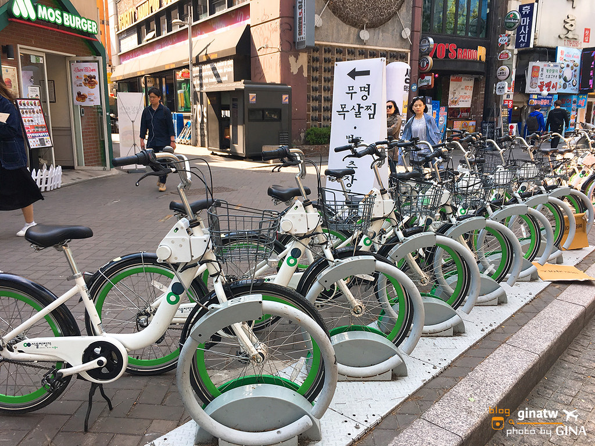

```{r install-package, include = FALSE, eval = FALSE}
# Copy and paste the following code into your console to download and install
# the `xaringan` package that contains all of the code which allows you 
# to create presentation slides in Rmarkdown
install.packages('xaringan')
```


```{r load-packages, include = FALSE}
# Add any additional packages you need to this chunk
library(tidyverse)
library(tidymodels)
library(palmerpenguins)
library(knitr)
library(xaringanthemer)
```

```{r setup, include=FALSE}
# For better figure resolution
knitr::opts_chunk$set(fig.retina = 3, dpi = 300, fig.width = 6, fig.asp = 0.618, out.width = "80%")

#Background image
style_xaringan()
```
# Research Questions

## RQ1
How does bike rental demand vary across different hours of the day and seasons?

## RQ2
How are weather conditions associated with hourly bike rental demand?

## RQ3
How do bike rental patterns differ between holidays and non-holidays?
---
# Dataset Overview

.pull-left[

**Data Source**
UCI Machine Learning Repository

**Dataset Characteristics**
- 8,760 original hourly observations
- 14 variables
- 8,465 observations after cleaning

**Data Preparation**
- Standardised column names
- Checked missing values and duplicates
- Removed 295 non-functioning hourly observations

]

.pull-right[

```{r echo=FALSE, out.width="100%"}

```

Photo source: [GINA](https://ginatw.com/seoulbike/)

]

---

class: inverse center middle

## RQ1: Time and Season
---
```{r load-data, include=FALSE}
# Load your data here
bike_data <- read_csv("data/SeoulBikeData.csv")
glimpse(bike_data)
bike_data <- bike_data %>%
  janitor::clean_names()
names(bike_data)

bike_data <- bike_data %>%
  rename(
    temperature = temperature_yin,
    dew_point_temperature = dew_point_temperature_yin
  )

names(bike_data)
sum(is.na(bike_data))
nrow(bike_data)
nrow(distinct(bike_data))
bike_clean <- bike_data %>%
  filter(functioning_day == "Yes")

glimpse(bike_clean)

nrow(bike_clean)
bike_clean %>%
  distinct(date, hour) %>%
  nrow()

hourly_rentals <- bike_clean %>%
  group_by(hour) %>%
  summarise(
    avg_rentals = mean(rented_bike_count)
  )

```

#Hourly Bike Rental Patterns
.pull-left[
```{r echo=FALSE, out.width="100%"}
ggplot(hourly_rentals, aes(x = hour, y = avg_rentals)) +
  geom_line(colour = "blue") +
  labs(
    title = "Average hourly bike rentals in Seoul",
    x = "Hour of the Day",
    y = "Average Number of Bike Rentals Per Hour"
  ) +
  theme_minimal()
```
]

.pull-right[
###Key Findings
- Two peaks at 8 am and 6 pm.
- Evening peak: approximately 1,550 rentals per hour.
- Lowest demand around 4–5 am.
- The pattern may be associated with commuting.
]
---

# Average Hourly Bike Rentals by Season
.pull-left[
```{r echo=FALSE, out.width="100%"}
seasonal_avg <- bike_clean %>%
  group_by(seasons) %>%
  summarise(
    avg_rentals = mean(rented_bike_count)
  )
  ggplot(seasonal_avg,
       aes(
         x = factor(seasons,
                    levels = c("Spring", "Summer", "Autumn", "Winter")),
                    y = avg_rentals,
                    fill = seasons
                    )) +
  geom_col() +
  labs(
    title = "Average Bike Rentals by Season in Seoul",
    x = "Season",
    y = "Average Number of Bike Rentals Per Hour"
  ) +
  theme_minimal()
```
]

.pull-right[
###Key Findings
- Summer has the highest average rental demand.
- Autumn and spring show relatively high demand.
- Winter has the lowest rental demand.
- Seasonal differences are associated with weather conditions.
]
---

# Hourly Bike Rental Patterns by Season
.pull-left[
```{r echo=FALSE, out.width="100%", message=FALSE}
seasonal_rentals <- bike_clean %>%
  group_by(seasons, hour) %>%
  summarise(
    avg_rentals = mean(rented_bike_count)
  )
ggplot(seasonal_rentals,
       aes(x = hour, y = avg_rentals, colour = seasons)) +
  geom_line() +
  labs(
    title = "Hourly Bike Rentals Patterns by Season",
    x = "Hour of the Day",
    y = "Average Hourly Bike Rentals"
  ) +
  theme_minimal()
```
]

.pull-right[
### Key Findings
- Morning and evening peaks appear across seasons.
- Summer evening demand exceeds 2,000 rentals/hour.
- Winter has substantially lower rental demand.
- Rental patterns vary by both hour and season.
]
---
class: inverse center middle
## RQ2: Weather Conditions
---
# Bike Rentals VS Temperature
.pull-left[
```{r echo=FALSE, out.width="100%", message=FALSE}
ggplot(bike_clean,
       aes(x = temperature,
           y = rented_bike_count)) +
  geom_point(alpha = 0.1) +
  geom_smooth() +
  labs(
    title = "Bike Rentals vs Temperature",
    x = "Temperature (°C)",
    y = "Hourly Bike Rentals"
  ) +
  theme_minimal()
```
]

.pull-right[
### Key Findings
- Rental demand generally increases with temperature.
- Demand peaks at approximately 25–30°C.
- Demand decreases at higher temperatures.
- The relationship is non-linear.
- Temperature alone cannot fully explain rental demand.
]
---

# Bike Rentals vs Humidity
.pull-left[
```{r echo=FALSE, out.width="100%", message=FALSE}
ggplot(bike_clean,
       aes(x = humidity_percent,
           y = rented_bike_count)) +
  geom_point(alpha = 0.1) +
  geom_smooth() +
  labs(
    title = "Bike Rentals vs Humidity",
    x = "Humidity (%)",
    y = "Hourly Bike Rentals"
  ) +
  theme_minimal()
```
]

.pull-right[
### Key Findings
- Rental demand peaks at around 50% humidity.
- Demand decreases sharply above 75% humidity.
- The relationship is non-linear.
- Humidity alone cannot fully explain rental demand.
]
---

# Average Bike Rentals by Rainfall Level
.pull-left[
```{r echo=FALSE, out.width="100%", message=FALSE}
rainfall_level_avg <- bike_clean %>%
  mutate(rain_level = case_when(
    rainfall_mm == 0 ~ "No Rain",
    rainfall_mm > 0 & rainfall_mm <= 2 ~ "0-2 mm",
    rainfall_mm > 2 & rainfall_mm <= 5 ~ "2-5 mm",
    rainfall_mm > 5 ~ "Above 5 mm"
  )) %>%
  group_by(rain_level) %>%
  summarise(avg_rentals = mean(rented_bike_count),
            n = n()
            )

ggplot(rainfall_level_avg,
       aes(x = factor(rain_level,
                      levels = c("No Rain", "0-2 mm", "2-5 mm", "Above 5 mm")),
           y = avg_rentals
           )) +
  geom_col() +
  labs(
    title = "Average Bike Rentals by Rainfall Level",
    x = "Rainfall Level",
    y = "Average Hourly Bike Rentals"
  ) +
  theme_minimal()
```
]

.pull-right[
### Key Findings
- Dry conditions: approximately 765 rentals/hour.
- Light rainfall: around 200 rentals/hour.
- Demand remains low during heavier rainfall.
- Rainfall is negatively associated with rental demand.
]
---

```{r regression-models, include=FALSE}
#Basic Model 1: Temperature Only
temp_fit <- linear_reg() %>%
  set_engine("lm") %>%
  fit(rented_bike_count ~ temperature,
      data = bike_clean)

#Model 2: Weather Variables
weather_data <- bike_clean %>%
  mutate(rain_status = case_when(
    rainfall_mm == 0 ~ "No Rain",
    rainfall_mm > 0 ~ "Rain"
  ))

weather_fit <- linear_reg() %>%
  set_engine("lm") %>%
  fit(rented_bike_count ~ temperature +
        humidity_percent + rain_status,
      data = weather_data)

#Model 3: Weather and other factors
weather_fit_2 <- linear_reg() %>%
  set_engine("lm") %>%
  fit(rented_bike_count ~ temperature +
        humidity_percent + rain_status +
        factor(hour) + seasons + holiday,
      data = weather_data)
```

# Regression Models and Equations

### Model 1: Temperature Only

Predicted hourly bike rentals = 348 + 29.9 × Temperature

### Model 2: Weather Variables

Predicted hourly bike rentals = 767.33 + 32.64 × Temperature
- 7.33 × Humidity - 473.55 × Rain Status

Rain Status: 0 = No Rain, 1 = Rain.

### Model 3: Weather and Other Factors

Additional variables: Hour, Season and Holiday Status.

---

# Regression Model Comparison

```{r echo=FALSE}
model_comparison <- data.frame(
  Model = c("Temperature Only",
            "Weather Model",
            "Adjusted Weather Model"),
  R_squared = c(0.317, 0.433, 0.677),
  Adjusted_R_squared = c(0.317, 0.432, 0.676),
  Sigma = c(531.02, 483.91, 365.85)
)

kable(model_comparison)
```

### Key Findings

- R-squared increases from 0.317 to 0.677.
- Adjusted R-squared increases across all three models.
- Residual standard error decreases from 531.02 to 365.85.
- Model 3 provides the best fit to the observed data.

---

# Regression Coefficients Comparison

```{r echo=FALSE}
coefficient_comparison <- data.frame(
  Variable = c("Temperature",
               "Humidity",
               "Rain Status"),
  Weather_Model = c(32.64, -7.33, -473.55),
  Adjusted_Weather_Model = c(24.46, -5.63, -522.56)
)

kable(coefficient_comparison)
```

### Key Findings

- Temperature is positively associated with rental demand.
- Humidity and rainfall are negatively associated with rental demand.
- Rainy hours are associated with around 523 fewer rentals in Model 3, holding other variables constant.
- Coefficients change after accounting for hour, season and holiday status.

---

#Residual Analysis for Model 3:
.pull-left[

```{r echo=FALSE, out.width="100%"}
weather_aug_2 <- augment(weather_fit_2$fit)

ggplot(weather_aug_2,
       aes(x = .fitted, y = .resid)) +
  geom_point(alpha = 0.1) +
  geom_hline(yintercept = 0,
             linetype = "dashed") +
  labs(
    title = "Residual Plot for Adjusted Weather Model",
    x = "Fitted Values",
    y = "Residuals"
  ) +
  theme_minimal()
```
]

.pull-right[
### Key Findings
- Residual variability increases at higher fitted values.
- The constant variance assumption may not hold.
- Some predicted rental counts are negative.
- The linear model has limitations despite its higher R-squared.
]
---

class: inverse center middle
## RQ3: Holiday Status
---
# Daily Bike Rentals: Holidays vs Non-Holidays
.pull-left[
```{r echo=FALSE, message=FALSE, out.width="100%"}
daily_rentals <- bike_clean %>%
    group_by(date, holiday) %>%
  summarise(sum_rentals = sum(rented_bike_count),
            n_hours = n()
            ) %>%
  filter(n_hours == 24)

ggplot(daily_rentals,
       aes(x = holiday,
           y = sum_rentals,
           fill = holiday)) +
  geom_boxplot() +
  labs(
    title = "Daily Bike Rentals: Holidays vs Non-Holidays",
    x = "Day Type",
    y = "Daily Bike Rentals"
  ) +
  theme_minimal()
```
]

.pull-right[
### Key Findings
- Holiday median: approximately 7,000 rentals/day.
- Non-holiday median: approximately 19,000 rentals/day.
- Non-holidays generally have higher rental demand.
- The two distributions overlap considerably.
]
---

# Hourly Bike Rental Patterns by Holiday Status
.pull-left[
```{r echo=FALSE, out.width="100%", message=FALSE}
holiday_hourly <- bike_clean %>%
  group_by(holiday, hour) %>%
  summarise(
    avg_rentals = mean(rented_bike_count)
  )
ggplot(holiday_hourly,
       aes(x = hour,
           y = avg_rentals,
           colour = holiday)) +
  geom_line() +
  labs(
    title = "Hourly Bike Rental Patterns by Holiday Status",
    x = "Hour of the Day",
    y = "Average Hourly Bike Rentals",
  ) +
  theme_minimal()
```
]

.pull-right[
### Key Findings
- Non-holidays show two peaks at 8 am and 6 pm.
- Non-holiday evening peak: around 1,600 rentals/hour.
- Holiday demand peaks at around 875 rentals/hour in the late afternoon.
- These differences may be associated with commuting and leisure activities.
]
---

class:inverse center middle
##Findings & Discussion
---
class: middle
# Conclusion

### Time and Season

- Rental demand peaks at 8 am and 6 pm.
- Summer has the highest demand, while winter has the lowest.

### Weather Conditions

- Moderate temperatures and dry conditions are associated with higher rental demand.
- Model 3 explains 67.7% of the observed variation in hourly bike rentals.

### Holiday Status

- Non-holidays generally have higher rental demand.
- Different hourly rental patterns may reflect differences in commuting and leisure activities.
---

# Applications

### 1. Increase bike availability before morning and evening peak hours.

### 2. Allocate more bicycles during warmer seasons.

### 3. Consider weather conditions when planning bike distribution.

### 4. Adopt different allocation strategies for holidays and non-holidays.

---
class:middle
# Key Limitations

### Data Limitations

- Observational data cannot establish causation.
- Actual trip purposes are not recorded.
- The dataset covers only one city and a limited time period.
- Holiday and non-holiday sample sizes are unequal.

### Model Limitations

- Potential confounding between weather and temporal variables.
- Linear regression may not capture non-linear relationships.
- Hourly observations may not be independent.
- Model performance was not evaluated on independent test data.
---

